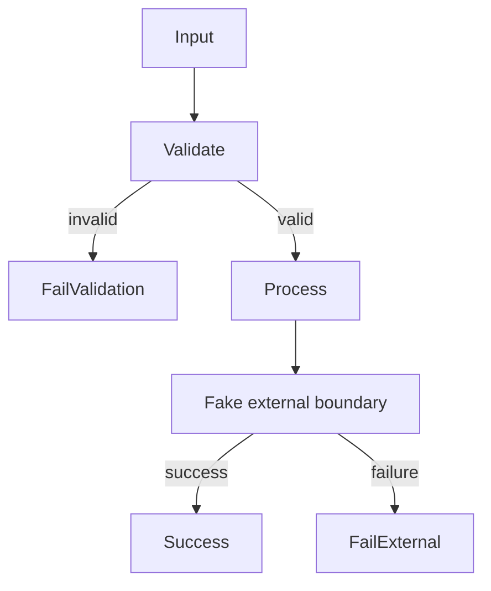
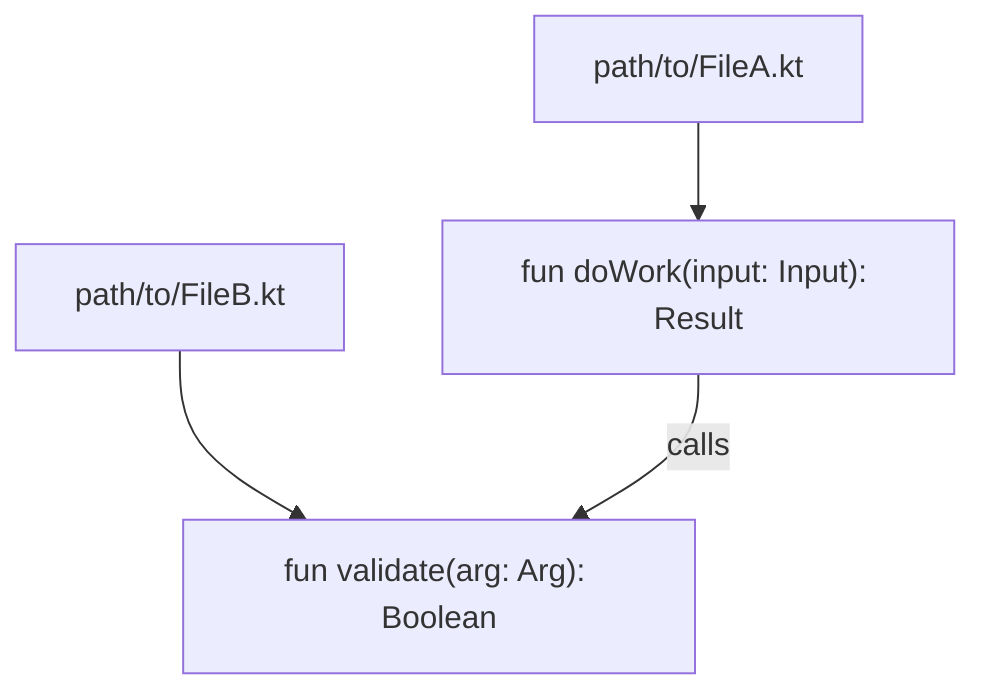

# Report and Matrix Templates

Adapt paths to project convention (e.g. `.ai-workflow/reports/`). Content requirements come from `AGENTS.md`.

## Test case matrix (Phase 1)

```markdown
# Test Case Matrix: <feature-id>

| ID | Behavior / edge case | Status | Test(s) | Report section |
|----|----------------------|--------|---------|----------------|
| TC-001 | Main success flow | covered | `testName()` | § Successful flows |
| TC-002 | Empty input | covered | `testEmpty()` | § Failure flows |
| TC-003 | ... | pending | — | § Edge cases |

## Coverage gaps

- TC-00X: defined in report but no executable test because ...
```

Status values: `covered`, `pending`, `not applicable`.

## Phase 1 report outline

```markdown
# Phase 1 Report: <feature-id>

## 1. Feature summary

## 2. Files created or changed

## 3. Code organization

## 4. Public interfaces and function signatures

## 5. Input and output types

## 6. Data-flow diagram



## 7. State transitions

## 8. Successful flows

## 9. Failure flows

## 10. Edge-case matrix

## 11. Test-to-behavior mapping

## 12. Required Phase 2 technologies

### Capability: <name>
- Behavior requiring it:
- Exists in project:
- Existing technology:
- Proposed:
- Alternatives:
- Config / permissions / compatibility / lifecycle / errors / performance / security:
- Testing approach:
- Experiment recommended:
- **Human decision:**

## 13. Proposed libraries, frameworks, SDKs, platform APIs

## 14. Alternative technical approaches

## 15. New code justification

## 16. Intentionally unsupported behavior

## 17. Test execution results

## 18. Questions requiring human decisions

## Function relationship map



## Contract files

- `path/to/file1.kt`
- `path/to/file2.kt`
```

## Phase 2 report outline

```markdown
# Phase 2 Report: <feature-id>

## 1. Files created or changed

## 2. Approved contract integrity

- Phase 1 files unchanged: yes/no (details)
- Behavior tests unchanged: yes/no

## 3. Real implementation summary

## 4. Function-by-function implementation mapping

| Function | Phase 1 behavior | Technology | Error conversion | Tests |

## 5–9. Libraries / frameworks / SDKs / platform APIs / external APIs

## 10. Configuration changes

## 11. Permission changes

## 12. Input and output conversion

## 13. Error conversion

## 14. Concurrency and cancellation

## 15. Performance considerations

## 16. Security and privacy considerations

## 17. Integration tests

## 18. Full test results

## 19. Static-analysis results

## 20. Known limitations

## 21. Questions requiring human decisions
```

## Function relationship diagram rules

- Full function signatures in node labels
- File path per file node
- Caller → callee edges labeled `calls`
- Show cross-file dependencies clearly
