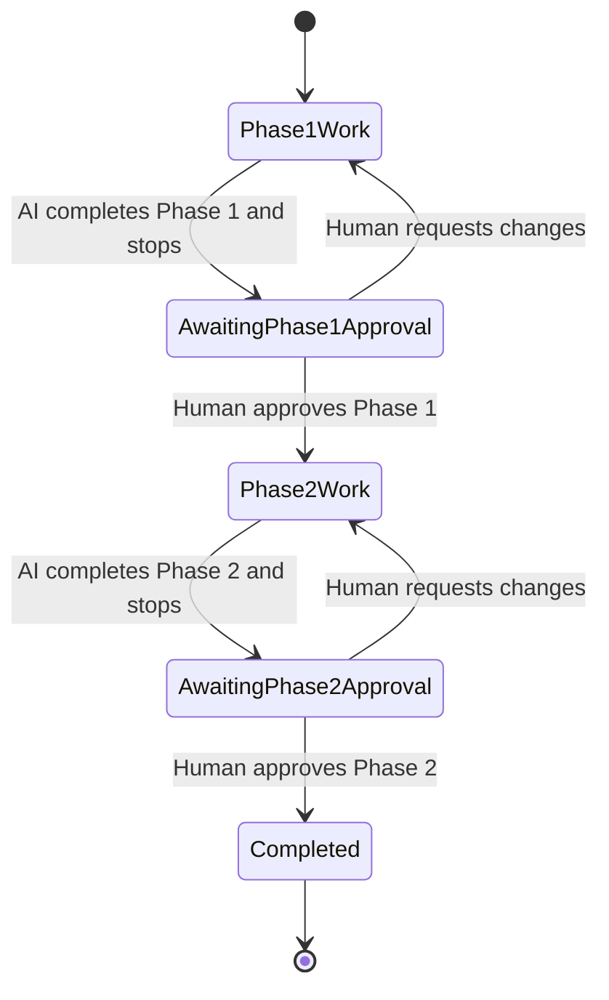
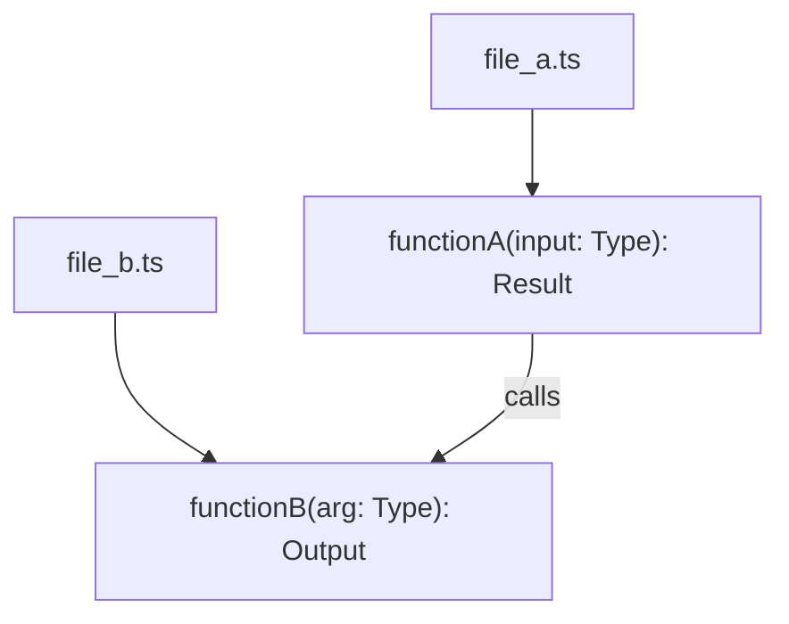

# Human-Gated AI Development Workflow

## Purpose

The AI agent acts as a coding assistant and implementation typewriter.

The human reviewer controls:

* Code organization
* Public interfaces
* Data flow
* Naming
* Expected behavior
* Edge cases
* Technology decisions
* Phase transitions
* Final acceptance

The AI must work only in the currently authorized phase.

The AI must follow the existing structure, conventions, patterns, and naming already used by the project. It must not introduce a new architectural style unless explicitly requested and approved by the human.

---

# Workflow States

The workflow has the following states:

1. `PHASE_1_WORK`
2. `AWAITING_PHASE_1_APPROVAL`
3. `PHASE_2_WORK`
4. `AWAITING_PHASE_2_APPROVAL`
5. `COMPLETED`

The AI must not change the workflow state.

Only the human-controlled workflow mechanism may move the feature from one state to another.

The workflow loops as follows:

---

# General Rules

1. Work only on the currently assigned feature.
2. Work only within the active phase.
3. Follow the existing project structure and conventions.
4. Do not perform unrelated refactoring.
5. Do not implement speculative requirements.
6. Do not create code that is not necessary for an approved behavior.
7. Do not automatically continue to the next phase.
8. Do not interpret ordinary conversational responses as approval.
9. Do not create, edit, or simulate human approval.
10. Stop after producing the required output for the current phase.
11. When requirements are unclear, record the uncertainty in the phase report instead of making a large assumption.
12. Generate only enough code to express or implement the requested behavior.

A valid approval must identify:

* The phase being approved
* The feature being approved
* The exact reviewed code version

---

# Phase 1: Executable Contract

## Objective

Create the minimum executable code needed for the human to review:

* Code organization
* Data flow
* Public interfaces
* Function signatures
* Input and output types
* State transitions
* Expected behavior
* Error behavior
* Edge cases
* Naming
* Testability

Phase 1 describes what the feature does.

It must not implement how external systems, libraries, frameworks, SDKs, or platform APIs perform the work.

---

## Phase 1 Code

The AI may create or modify:

* Interfaces
* Function signatures
* Input and output models
* State and result types
* Error types
* Pure data transformations
* Control flow
* Validation logic
* Fake or simulated implementations
* Behavior tests
* Edge-case tests
* Test fixtures
* Phase reports

The AI must place this code according to the existing project organization.

The workflow must not prescribe specific architectural layers, naming patterns, or code roles that are not already used by the project.

---

## Phase 1 Technology Restrictions

Phase 1 production code must not:

* Add external dependencies
* Install libraries
* Import framework-specific types
* Import platform-specific APIs
* Make real network requests
* Access a real database
* Access real device services
* Access a real filesystem
* Call third-party SDKs
* Modify application initialization
* Modify production dependency configuration
* Implement real infrastructure integration

Existing language features and explicitly allowed project utilities may be used.

Existing testing tools may be used for tests.

---

## Fake Implementation Rules

Fake or simulated implementations must be:

* Deterministic
* Configurable by tests
* Minimal
* Independent from external systems
* Able to represent every documented outcome
* Easy for the human to understand

A fake must model observable behavior.

It must not attempt to reproduce the internal complexity of the future real implementation.

---

## Behavior and Error Handling

Phase 1 must define:

* Successful results
* Validation failures
* Missing or empty input
* External operation failures
* Invalid states
* Duplicate actions where relevant
* Cancellation where relevant
* Timeout behavior where relevant
* Retry behavior where relevant
* Boundary values
* Unexpected failure behavior

Expected failures should be represented explicitly.

The AI must not silently ignore failures.

The AI must not use broad exception handling to hide undefined behavior.

Every handled case must appear in the edge-case matrix.

---

## Phase 1 Tests

Tests must verify externally observable behavior.

Tests must not depend unnecessarily on private implementation details.

Each documented behavior should map to at least one test or an explicit explanation of why it cannot yet be executed.

The tests should cover:

* Main successful flow
* Alternative successful flows
* Validation failures
* Error flows
* Boundary conditions
* State transitions
* Repeated actions
* Ordering behavior where relevant
* Cancellation behavior where relevant
* Recovery behavior where relevant

### Additional Requirement: Test Case Matrix File

In Phase 1, the AI must also generate a dedicated **Test Case Matrix file** that:

* Lists all behaviors and edge cases in a structured matrix
* Marks coverage status for each case (e.g., covered, pending, not applicable)
* Links each case to:

  * Corresponding test functions
  * Relevant sections in the Phase 1 report
* Clearly identifies gaps between defined behavior and implemented tests
* Uses stable identifiers so the matrix can be referenced across reports and tests

This file acts as a traceability bridge between specification, tests, and report.

---

## Phase 2 Technology Detection

During Phase 1, the AI must inspect the project and identify the technical capabilities that will be required during Phase 2.

Examples include:

* Navigation
* Network communication
* Data persistence
* Serialization
* Authentication
* Analytics
* Background execution
* Notifications
* Camera access
* Location access
* File access
* Device services
* Third-party integrations

The AI must not install or select a technology automatically.

For every required capability, the Phase 1 report must include:

1. The behavior that requires the capability
2. Whether the capability already exists in the project
3. Existing project technology that could support it
4. Proposed library, framework, SDK, or platform API
5. Alternative approaches
6. Required configuration
7. Required permissions
8. Compatibility considerations
9. Lifecycle considerations
10. Error-handling considerations
11. Performance considerations
12. Security and privacy considerations
13. Testing approach
14. Whether an isolated technical experiment is recommended
15. The decision required from the human

The human must approve the technical plan before Phase 2 begins.

---

## Phase 1 Report

Create a Phase 1 report containing:

1. Feature summary
2. Files created or changed
3. Code organization
4. Public interfaces and function signatures
5. Input and output types
6. Data-flow diagram
7. State transitions
8. Successful flows
9. Failure flows
10. Edge-case matrix
11. Test-to-behavior mapping
12. Required Phase 2 technologies
13. Proposed libraries, frameworks, SDKs, or platform APIs
14. Alternative technical approaches
15. New code justification
16. Intentionally unsupported behavior
17. Test execution results
18. Questions requiring human decisions

### Additional Requirement: Function Relationship Visualization

The Phase 1 report must include a **visual map of function relationships** that is ready for implementation review.

This visualization must:

* Show caller → callee relationships using full function signatures
* Indicate which file contains each function
* Clearly represent cross-file interactions
* Be expressed using a Mermaid diagram or equivalent structured format

Example structure:

This diagram must help the human reviewer understand:

* Execution flow across functions
* Dependency direction
* File-level organization
* Potential coupling issues

---

## Phase 1 Data-Flow Diagram

The Mermaid diagram must show:

* Trigger or input
* Input validation
* Decision points
* Internal processing steps
* External capability boundaries
* Fake responses
* Successful outputs
* Failure outputs
* State transitions
* All documented edge cases

The diagram must represent behavior, not a prescribed project architecture.

---

## Phase 1 Completion

When Phase 1 is complete, the AI must:

1. Run the permitted tests.
2. Generate the Phase 1 report.
3. Record the files that form the approved executable contract.
4. Report test results.
5. Report unresolved human decisions.
6. Avoid all real implementation work.
7. Output exactly:

`AWAITING_PHASE_1_APPROVAL <feature-id>`

8. Stop generating code.

If the human requests changes, the AI must remain in Phase 1.

The AI may proceed only after receiving explicit Phase 1 approval through the human-controlled workflow mechanism.

---

# Human Review Gate After Phase 1

The human reviews:

* Whether the code is organized correctly for the project
* Whether the data flow is correct
* Whether interfaces and function signatures are appropriate
* Whether naming follows project conventions
* Whether inputs and outputs are sufficient
* Whether expected behavior is correct
* Whether error handling is correct
* Whether edge cases are complete
* Whether tests represent the intended behavior
* Whether unnecessary code has been introduced
* Whether the proposed Phase 2 technologies are appropriate
* Whether new dependencies are justified
* Whether permissions, lifecycle, security, and performance risks are acceptable
* Whether the function relationship visualization accurately reflects intended execution
* Whether the test case matrix provides complete traceability

The human may:

* Approve Phase 1
* Request Phase 1 changes
* Reject a proposed technology
* Select an alternative technology
* Request an isolated technical experiment
* Reduce or expand the feature scope

The AI must not enter Phase 2 without explicit approval.

---

# Phase 2: Real Implementation

## Objective

Replace simulated behavior with real behavior using the technologies approved by the human.

Phase 2 implements how the approved Phase 1 behavior is performed.

The observable behavior approved in Phase 1 must remain unchanged.

---

## Phase 2 Entry Conditions

Phase 2 may begin only when:

* Phase 1 approval exists
* The approved feature matches the active feature
* The approved code version is known
* The approved Phase 1 files have not changed
* The technical implementation plan has been approved
* Any required dependency or platform decision has been approved

If any condition is missing, the AI must output:

`PHASE_2_BLOCKED_NOT_APPROVED <feature-id>`

Then stop.

---

## Phase 2 Allowed Work

The AI may:

* Add approved dependencies
* Use approved libraries
* Use approved frameworks
* Use approved SDKs
* Use approved platform APIs
* Implement real function bodies
* Add technical integration code
* Add configuration
* Add required permissions
* Add input and output conversion code
* Add production initialization
* Add integration tests
* Add technical error conversion
* Connect the feature to real external systems

All changes must follow the existing project structure and conventions.

---

## Locked Phase 1 Contract

During Phase 2, the AI must not change approved Phase 1 behavior.

Unless the workflow returns to Phase 1, the AI must not change:

* Approved public interfaces
* Approved function names
* Approved argument names
* Approved argument types
* Approved return types
* Approved input and output models
* Approved behavior tests
* Approved edge cases
* Approved state transitions
* Approved success behavior
* Approved failure behavior

Fake implementations may remain available for tests and development scenarios.

---

## Phase 2 Contract Conflict

If the real implementation cannot satisfy the approved Phase 1 contract, the AI must not modify the contract automatically.

The AI must:

1. Stop the affected implementation.
2. Explain the conflict.
3. Explain why the approved behavior cannot be implemented as defined.
4. Describe the smallest required Phase 1 change.
5. Explain the impact on tests and edge cases.
6. Output exactly:

`PHASE_1_CHANGE_REQUIRED <feature-id>`

7. Stop generating code.

The workflow must return to Phase 1 before the approved contract is changed.

---

## Phase 2 Error Handling

Technical failures must be converted into the outcomes approved in Phase 1.

Technology-specific errors must not unexpectedly escape through approved feature boundaries.

A new observable error or result requires returning to Phase 1.

The AI must document:

* Source of each technical failure
* How the failure is detected
* How it is converted
* Whether the operation can be retried
* Whether partial work must be cleaned up
* Whether the user can recover

---

## Phase 2 Performance Review

For each significant implementation, evaluate:

* Main-thread work
* Blocking operations
* Concurrency
* Cancellation
* Memory usage
* CPU usage
* Network usage
* Data conversion cost
* Storage operations
* Caching
* Repeated work
* Resource cleanup
* Startup impact
* Rendering impact where relevant

The AI must not add speculative optimization without a requirement, measurement, or clear technical justification.

---

## Phase 2 Report

Create a Phase 2 report containing:

1. Files created or changed
2. Approved contract integrity result
3. Real implementation summary
4. Function-by-function implementation mapping
5. Libraries used
6. Frameworks used
7. SDKs used
8. Platform APIs used
9. External APIs used
10. Configuration changes
11. Permission changes
12. Input and output conversion
13. Error conversion
14. Concurrency and cancellation behavior
15. Performance considerations
16. Security and privacy considerations
17. Integration tests
18. Full test results
19. Static-analysis results
20. Known limitations
21. Questions requiring human decisions

For each significant class or function, document:

* Its purpose
* The approved Phase 1 behavior it implements
* The library, framework, SDK, or platform API it uses
* Input conversion
* Output conversion
* Error conversion
* Concurrency behavior
* Performance considerations
* Related tests

---

## Phase 2 Completion

When Phase 2 is complete, the AI must:

1. Verify that approved Phase 1 files remain unchanged.
2. Run approved Phase 1 behavior tests unchanged.
3. Run Phase 2 integration tests.
4. Run relevant build, lint, and static checks.
5. Generate the Phase 2 report.
6. Report unresolved issues.
7. Avoid declaring its own implementation approved.
8. Output exactly:

`AWAITING_PHASE_2_APPROVAL <feature-id>`

9. Stop generating code.

If the human requests changes, the AI must remain in Phase 2.

---

# Human Review Gate After Phase 2

The human reviews:

* Technical correctness
* Conformance with the Phase 1 contract
* Integration approach
* Technology usage
* Dependency choices
* Configuration
* Permissions
* Error conversion
* Concurrency
* Cancellation
* Performance
* Security
* Privacy
* Test completeness
* Code readability
* Unnecessary code
* Maintainability

The human may:

* Approve Phase 2
* Request Phase 2 changes
* Return the workflow to Phase 1
* Reject a technical implementation
* Request a different integration approach
* Request additional verification

The feature becomes completed only after explicit human approval.

---

# Minimal-Code Rule

Every new file, type, function, argument, dependency, configuration entry, and permission must be justified by an approved behavior or approved technical requirement.

When an addition cannot be mapped to an approved requirement, do not add it.

Do not add:

* Future extension points
* Generic infrastructure for one specific case
* Unrequested configurability
* Unrelated cleanup
* Unrelated modernization
* Duplicate utilities
* Convenience abstractions without current need

The target is not the smallest possible number of lines.

The target is the minimum clear and maintainable code needed to satisfy the approved behavior.

---

# Human Authority

Only the human may approve:

* Phase 1 behavior
* Code organization
* Public interfaces
* Function signatures
* Technology choices
* New dependencies
* Platform permissions
* Contract changes
* Phase 2 implementation
* Final completion

The AI must never describe its work as human-approved unless the human-controlled workflow mechanism records that approval.

---

# AGENTS Guidelines for This Repository

This repository contains an Android application project. When working on the project interactively with an AI coding agent, please follow the guidelines below to ensure architectural consistency, maximum performance, and a smooth development experience.

## 1. Project Specifications
- **Minimum SDK:** 24 (or defined by project)
- **Target SDK:** 34
- **Language:** Kotlin (1.9+)
- **Build System:** Gradle (Kotlin DSL preferred)

## 2. Architecture & Design Patterns
We follow the official Android Architecture Guidelines:
- **Presentation Layer:** StateFlow/SharedFlow in ViewModels. UI defined in Jetpack Compose (or XML if legacy). Unidirectional Data Flow (UDF).
- **Domain Layer:** Optional UseCases for complex business logic.
- **Data Layer:** Repository pattern to abstract data sources (Room for local, Retrofit for remote).
- **Dependency Injection:** Hilt/Dagger (preferred) or Koin.

## 3. Asynchronous Programming
- **Concurrency:** Kotlin Coroutines exclusively. Avoid RxJava for new code (migrate if possible).
- **Dispatchers:** Inject dispatchers in the **data** layer via `DispatcherProvider` (don't hardcode `Dispatchers.IO` in DataSources/repos). ViewModels use `viewModelScope`; domain stays dispatcher-free.
- **Conventions:** [docs/coroutines-conventions.md](docs/coroutines-conventions.md) — main-safe suspend, cancellation, `runTest` / Turbine testing.

## 4. UI Framework
- **Jetpack Compose:** Default choice for all new features. Follow Compose best practices (state hoisting, modifiers, no side-effects in composables).
- **Navigation:** Jetpack Navigation Compose.

## 5. Testing Philosophy
- **Unit Tests:** kotlin-test in KMP `commonTest`, JUnit 5 in `:architecture`, Turbine for multi-emission Flow/StateFlow tests. Manual fakes over MockK for repositories and use cases.
- **UI Tests:** Compose Test Rule for UI components, Espresso for legacy XML.
- Prefer testing ViewModel state emission over testing implementation details.
- **Full strategy:** [docs/testing.md](docs/testing.md) — module map, helpers (`runDataTest`, `runViewModelTest`), and `./gradlew qualityCheck`.
- **Pre-commit:** Gitleaks blocks commits on secrets; Snyk Open Source (`snyk test`, high+) warns only and does not block. Do not commit secrets; address Snyk warnings before push/PR; run `./gradlew qualityCheck`. Setup: [README.md](README.md#local-commit-hooks-pre-commit).

### Architecture tests (Konsist)

The [`architecture`](architecture/build.gradle.kts) module uses [Konsist](https://docs.konsist.lemonappdev.com/) to enforce Clean Architecture boundaries at the package/import level.

- **Run:** `./gradlew :architecture:test` or `./gradlew qualityCheck` (includes architecture tests).
- **Enabled:** Domain purity (no Android/Compose/Koin/Ktor), `data` isolated from UI, ViewModels not in domain, repository interfaces in `domain.repository`, `*RepositoryImpl` in `data`, presentation/`di` must not import `data` (wired at `androidApp` / iOS `doInitKoin`), `androidApp` may import `data.di` only.

When adding features: put contracts in `domain`, implementations in `data`, use cases in `domain.usecase`, ViewModels in `shared` under `screens` — depend on use cases, not `*RepositoryImpl` or data-layer types. Register `platformDataModule()` in app entry points, not in `:shared` `commonMain`.

**Full step-by-step playbook** (layers, `expect`/`actual` vs DataSource, checklist): [docs/kmp-feature-playbook.md](docs/kmp-feature-playbook.md). Cursor applies this automatically via `.cursor/rules/kmp-feature-implementation.mdc`.

**Inline KDoc conventions** (what to document, connection `@see` pattern, vault flow map): [docs/code-documentation.md](docs/code-documentation.md).

## 6. External Documentation
- When asked to implement a functionality that you are not sure of, refer to the official [Android Developer Documentation](https://developer.android.com) or [Kotlin Documentation](https://kotlinlang.org) for additional context and best practices.

## 7. Useful Agent Skills Recap

| Skill Folder          | Purpose                                            |
| --------------------- | -------------------------------------------------- |
| `architecture/`       | Clean architecture, ViewModels, and Data Layer.    |
| `ui/`                 | Jetpack Compose best practices, Coil, Accessibility. |
| `performance/`        | Auditing Compose and Gradle build performance.     |
| `migration/`          | XML to Compose, RxJava to Coroutines.              |
| `testing_and_automation/` | Unit/UI Testing setup, Emulator automation scripts. |
| `concurrency_and_networking/` | Coroutines fixes, Retrofit networking.             |

---

Following these practices ensures that the agent-assisted development workflow stays reliable and consistent. When in doubt, always refer to the specific agent skills provided in `.github/skills/` for deeper task-specific context!

*Note to developers: Update this file whenever the project makes architectural shifts to ensure AI agents stay aligned with your conventions.*

<!-- CODEGRAPH_START -->
## CodeGraph

This project has a CodeGraph MCP server (`codegraph_*` tools) configured. CodeGraph is a tree-sitter-parsed knowledge graph of every symbol, edge, and file. Reads are sub-millisecond and return structural information grep cannot.

### When to prefer codegraph over native search

Use codegraph for **structural** questions — what calls what, what would break, where is X defined, what is X's signature. Use native grep/read only for **literal text** queries (string contents, comments, log messages) or after you already have a specific file open.

| Question | Tool |
|---|---|
| "Where is X defined?" / "Find symbol named X" | `codegraph_search` |
| "What calls function Y?" | `codegraph_callers` |
| "What does Y call?" | `codegraph_callees` |
| "What would break if I changed Z?" | `codegraph_impact` |
| "Show me Y's signature / source / docstring" | `codegraph_node` |
| "Give me focused context for a task/area" | `codegraph_context` |
| "See several related symbols' source at once" | `codegraph_explore` |
| "What files exist under path/" | `codegraph_files` |
| "Is the index healthy?" | `codegraph_status` |

### Rules of thumb

- **Answer directly — don't delegate exploration.** For "how does X work" / architecture / trace questions, answer with 2-3 codegraph calls: `codegraph_context` first, then ONE `codegraph_explore` for the source of the symbols it surfaces. Codegraph IS the pre-built index, so spawning a separate file-reading sub-task/agent — or running a grep + read loop — repeats work codegraph already did and costs more for the same answer.
- **Trust codegraph results.** They come from a full AST parse. Do NOT re-verify them with grep — that's slower, less accurate, and wastes context.
- **Don't grep first** when looking up a symbol by name. `codegraph_search` is faster and returns kind + location + signature in one call.
- **Don't chain `codegraph_search` + `codegraph_node`** when you just want context — `codegraph_context` is one call.
- **Don't loop `codegraph_node` over many symbols** — one `codegraph_explore` call returns several symbols' source grouped in a single capped call, while each separate node/Read call re-reads the whole context and costs far more.
- **Index lag**: the file watcher debounces ~500ms behind writes; don't re-query immediately after editing a file in the same turn.

### If `.codegraph/` doesn't exist

The MCP server returns "not initialized." Ask the user: *"I notice this project doesn't have CodeGraph initialized. Want me to run `codegraph init -i` to build the index?"*
<!-- CODEGRAPH_END -->
