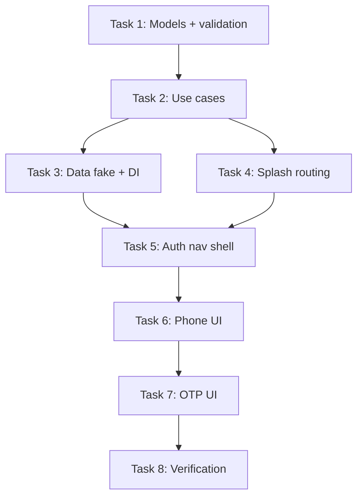

# Phone + OTP Authentication — Implementation Plan

> **For agentic workers:** Implement task-by-task. Steps use checkbox (`- [ ]`) syntax for tracking.

**Goal:** Add phone + OTP authentication (`feature/auth` in `:shared`) with fake backend, session-based splash routing, and Inert Code OTP UI.

**Architecture:** Domain `AuthRepository` + validation/masking use cases; `FakeAuthRepository` in `:data`; presentation in `shared/feature/auth` with internal typed nav (`PhoneNumberRoute` → `OtpVerificationRoute`); splash uses `GetUserSessionUseCase`; OTP success calls `SaveUserSessionUseCase` + `CompleteOnboardingUseCase`.

**Tech Stack:** Kotlin Multiplatform, Compose Multiplatform, Navigation Compose (type-safe `@Serializable` routes), Koin, kotlinx-coroutines, Turbine (ViewModel tests).

**Spec:** [`docs/superpowers/specs/2026-08-02-phone-otp-auth-design.md`](../specs/2026-08-02-phone-otp-auth-design.md)  
**Test matrix:** [`docs/superpowers/specs/2026-08-02-phone-otp-auth-test-matrix.md`](../specs/2026-08-02-phone-otp-auth-test-matrix.md)

---

## File map

| File | Responsibility |
|------|----------------|
| `domain/.../model/auth/CountryDialCode.kt` | Dropdown country model |
| `domain/.../model/auth/PhoneNumber.kt` | E.164 value type |
| `domain/.../model/auth/PhoneNumberInput.kt` | UI input model |
| `domain/.../model/auth/OtpChallenge.kt` | Challenge ID + resend timestamp |
| `domain/.../model/auth/AuthError.kt` | Sealed error types |
| `domain/.../model/auth/SupportedCountries.kt` | Static SG/MY/TH/ID/PH/VN list |
| `domain/.../util/PhoneNumberMasking.kt` | `maskPhoneNumber(PhoneNumber): String` |
| `domain/.../validation/PhoneNumberValidator.kt` | Per-country digit rules |
| `domain/.../repository/AuthRepository.kt` | Auth contract |
| `domain/.../usecase/auth/GetSupportedCountriesUseCase.kt` | Country list |
| `domain/.../usecase/auth/ValidatePhoneNumberUseCase.kt` | Local validation → `PhoneNumber` |
| `domain/.../usecase/auth/SendOtpUseCase.kt` | Send OTP |
| `domain/.../usecase/auth/ResendOtpUseCase.kt` | Resend OTP |
| `domain/.../usecase/auth/VerifyOtpUseCase.kt` | Verify code → `UserSession` |
| `data/.../auth/FakeAuthRepository.kt` | Fake backend (`123456`, 30s resend) |
| `shared/.../feature/auth/api/AuthNavigation.kt` | `AuthRoute`, `PhoneNumberRoute`, `OtpVerificationRoute` |
| `shared/.../feature/auth/api/AuthScreen.kt` | Auth NavHost + callbacks |
| `shared/.../feature/auth/api/AuthFeatureModule.kt` | Koin ViewModels |
| `shared/.../feature/auth/impl/phone/PhoneNumberViewModel.kt` | Phone screen logic |
| `shared/.../feature/auth/impl/phone/PhoneNumberUiState.kt` | Phone UI state |
| `shared/.../feature/auth/impl/phone/PhoneNumberContent.kt` | Phone composable |
| `shared/.../feature/auth/impl/otp/OtpVerificationViewModel.kt` | OTP logic + countdown |
| `shared/.../feature/auth/impl/otp/OtpVerificationUiState.kt` | OTP UI state |
| `shared/.../feature/auth/impl/otp/OtpVerificationContent.kt` | OTP composable (Inert Code) |
| `shared/.../App.kt` | Wire `AuthRoute`; remove onboarding from nav |
| `shared/.../feature/splash/impl/SplashViewModel.kt` | Session-based routing |
| `shared/.../feature/splash/impl/SplashScreenUiState.kt` | `Auth` destination |
| `shared/.../feature/splash/api/SplashScreen.kt` | `onNavigateToAuth` callback |

---

### Task 1: Domain models + validation + masking

**Files:**
- Create: `domain/src/commonMain/kotlin/com/devindie/cmptemplate/domain/model/auth/*.kt`
- Create: `domain/src/commonMain/kotlin/com/devindie/cmptemplate/domain/validation/PhoneNumberValidator.kt`
- Create: `domain/src/commonMain/kotlin/com/devindie/cmptemplate/domain/util/PhoneNumberMasking.kt`
- Create: `domain/src/commonTest/kotlin/com/devindie/cmptemplate/domain/validation/PhoneNumberValidatorTest.kt`
- Create: `domain/src/commonTest/kotlin/com/devindie/cmptemplate/domain/util/PhoneNumberMaskingTest.kt`

- [ ] **Step 1:** Add `SupportedCountries.default` (SG default) with 6 entries per spec.
- [ ] **Step 2:** Implement `PhoneNumberValidator.validate(input: PhoneNumberInput): Result<PhoneNumber>` with per-ISO rules; build E.164 as `dialCode + localDigits` (no spaces).
- [ ] **Step 3:** Implement `maskPhoneNumber`: `+6587654321` → `+65 •••• 4321` (last 4 of local digits).
- [ ] **Step 4:** Write tests for each country boundary + masking (matrix E02, E13, E18).
- [ ] **Step 5:** Run `./gradlew :domain:test --tests "*PhoneNumber*"`.

---

### Task 2: Domain repository + use cases

**Files:**
- Create: `domain/src/commonMain/kotlin/com/devindie/cmptemplate/domain/repository/AuthRepository.kt`
- Create: `domain/src/commonMain/kotlin/com/devindie/cmptemplate/domain/usecase/auth/*.kt` (5 use cases)
- Create: `domain/src/commonTest/kotlin/com/devindie/cmptemplate/domain/fake/FakeAuthRepository.kt`
- Create: `domain/src/commonTest/kotlin/com/devindie/cmptemplate/domain/usecase/auth/*.kt`
- Modify: `shared/src/commonMain/kotlin/com/devindie/cmptemplate/core/di/AppDomainModule.kt`

- [ ] **Step 1:** Define `AuthRepository` interface per spec.
- [ ] **Step 2:** Implement use cases — `ValidatePhoneNumberUseCase` delegates to `PhoneNumberValidator`; others delegate to repository.
- [ ] **Step 3:** Create `FakeAuthRepository` in **domain test** package for unit tests (in-memory challenges map, code `123456`, new UUID per send/resend).
- [ ] **Step 4:** Tests — send returns challenge; verify `123456` succeeds; wrong code → `OtpInvalid`; resend returns new `challengeId` (E07, E09).
- [ ] **Step 5:** Register auth use cases in `AppDomainModule` via `factoryOf`.
- [ ] **Step 6:** Run `./gradlew :domain:test`.

---

### Task 3: Data — production FakeAuthRepository + DI

**Files:**
- Create: `data/src/commonMain/kotlin/com/devindie/cmptemplate/data/auth/FakeAuthRepository.kt`
- Create: `data/src/commonTest/kotlin/com/devindie/cmptemplate/data/auth/FakeAuthRepositoryTest.kt`
- Modify: `data/src/androidMain/kotlin/com/devindie/cmptemplate/data/di/PlatformDataModule.android.kt`
- Modify: `data/src/iosMain/kotlin/com/devindie/cmptemplate/data/di/PlatformDataModule.ios.kt`

- [ ] **Step 1:** Implement `FakeAuthRepository` in `data` (mirror domain test fake; ~500ms `delay` on send/verify/resend using `DispatcherProvider` if needed, or simple delay in commonMain).
- [ ] **Step 2:** Bind `single<AuthRepository> { FakeAuthRepository() }` in both platform modules.
- [ ] **Step 3:** Data-layer tests for fake behavior.
- [ ] **Step 4:** Run `./gradlew :data:test --tests "*FakeAuth*"`.

---

### Task 4: Splash — session-based routing

**Files:**
- Modify: `shared/.../feature/splash/impl/SplashScreenUiState.kt`
- Modify: `shared/.../feature/splash/impl/SplashViewModel.kt`
- Modify: `shared/.../feature/splash/api/SplashScreen.kt`
- Modify: `shared/src/commonTest/.../feature/splash/impl/SplashViewModelTest.kt`

- [ ] **Step 1:** Replace `SplashPostStartupDestination.Onboarding` with `Auth`.
- [ ] **Step 2:** Inject `GetUserSessionUseCase`; route Main if session non-null, else Auth.
- [ ] **Step 3:** Update `SplashScreen` — rename callback to `onNavigateToAuth`; handle `Auth` destination in `LaunchedEffect`.
- [ ] **Step 4:** Update tests — use `FakeUserRepository` with/without session (E10, E11); remove onboarding-based assertions.
- [ ] **Step 5:** Run `./gradlew :shared:test --tests "*SplashViewModel*"`.

---

### Task 5: Auth feature — navigation shell

**Files:**
- Create: `shared/.../feature/auth/api/AuthNavigation.kt`
- Create: `shared/.../feature/auth/api/AuthScreen.kt`
- Create: `shared/.../feature/auth/api/AuthFeatureModule.kt`
- Modify: `shared/.../core/di/AppDomainModule.kt` (include `authFeatureModule`)
- Modify: `shared/.../App.kt`

- [ ] **Step 1:** Define `@Serializable` routes: `AuthRoute`, `PhoneNumberRoute`, `OtpVerificationRoute(challengeId, maskedPhone, resendAvailableAtEpochMs)`.
- [ ] **Step 2:** `AuthScreen(onAuthComplete)` — internal `NavHost` starting at `PhoneNumberRoute`.
- [ ] **Step 3:** `authFeatureModule` — `viewModelOf` for both ViewModels.
- [ ] **Step 4:** `App.kt` — replace `OnboardingRoute` with `AuthRoute`; splash navigates to auth with `popUpTo<SplashRoute> { inclusive = true }`.
- [ ] **Step 5:** Compile check: `./gradlew :shared:compileDebugKotlinAndroid` (or `:shared:compileKotlinIosSimulatorArm64`).

---

### Task 6: Phone Number screen (Figma `12:755`)

**Files:**
- Create: `shared/.../feature/auth/impl/phone/PhoneNumberUiState.kt`
- Create: `shared/.../feature/auth/impl/phone/PhoneNumberViewModel.kt`
- Create: `shared/.../feature/auth/impl/phone/PhoneNumberContent.kt`
- Create: `shared/src/commonTest/.../feature/auth/impl/phone/PhoneNumberViewModelTest.kt`

- [ ] **Step 1:** `PhoneNumberUiState` per spec; init countries from `GetSupportedCountriesUseCase`.
- [ ] **Step 2:** ViewModel — on digit/country change call `ValidatePhoneNumberUseCase`; toggle `isNextEnabled`.
- [ ] **Step 3:** On Next — `SendOtpUseCase`; on success emit navigation event with `challengeId`, `maskPhoneNumber(phone)`, `resendAvailableAtEpochMs`.
- [ ] **Step 4:** `PhoneNumberContent` — title, subtitle, `ExposedDropdownMenuBox` (flag + dial code), phone `TextField`, Next `Button`; test tags per spec.
- [ ] **Step 5:** Wire in `AuthScreen` NavHost with `navigate(OtpVerificationRoute(...))`.
- [ ] **Step 6:** ViewModel tests (E01, E03, E04, E15) using domain `FakeAuthRepository` + Turbine.
- [ ] **Step 7:** `@Preview` for phone screen.

---

### Task 7: OTP Verification screen (Figma `Inert Code` `12:35`)

**Files:**
- Create: `shared/.../feature/auth/impl/otp/OtpVerificationUiState.kt`
- Create: `shared/.../feature/auth/impl/otp/OtpVerificationViewModel.kt`
- Create: `shared/.../feature/auth/impl/otp/OtpVerificationContent.kt`
- Create: `shared/src/commonTest/.../feature/auth/impl/otp/OtpVerificationViewModelTest.kt`

- [ ] **Step 1:** ViewModel reads route args (`challengeId`, `maskedPhone`, `resendAvailableAtEpochMs`); start countdown ticker from timestamp.
- [ ] **Step 2:** On 6 digits — `VerifyOtpUseCase`; success → `SaveUserSessionUseCase` + `CompleteOnboardingUseCase` → emit `authComplete`.
- [ ] **Step 3:** Resend when countdown == 0 — `ResendOtpUseCase`; update stored `challengeId` + timer; clear digits.
- [ ] **Step 4:** `OtpVerificationContent` — back chevron (`popBackStack`), instruction line, masked phone, inline 32sp OTP field + × clear, resend hint lines (Inert Code layout).
- [ ] **Step 5:** Back navigation retains phone VM state (default NavController behavior — verify manually).
- [ ] **Step 6:** ViewModel tests (E06, E08, E09, E12, E14, E16).
- [ ] **Step 7:** `@Preview` for OTP screen.

---

### Task 8: Integration verification

- [ ] **Step 1:** Run `./gradlew :architecture:test` — domain purity, no presentation importing data impls incorrectly.
- [ ] **Step 2:** Run `./gradlew :domain:test :shared:test :data:test`.
- [ ] **Step 3:** Run `./gradlew qualityCheck` if time permits.
- [ ] **Step 4:** Manual smoke — fresh install: Splash → Phone → enter `87654321` → OTP `123456` → Main.
- [ ] **Step 5:** Manual — second launch with session: Splash → Main.
- [ ] **Step 6:** Manual — back from OTP retains phone number; resend countdown works.
- [ ] **Step 7:** Update test matrix statuses (`covered`) for implemented cases.

---

## Dependency order

Tasks 3–4 can run in parallel after Task 2.

---

## Out of scope (do not implement)

- Delete `feature/onboarding` package
- Real Ktor OTP endpoints
- Login landing / Google verify
- SMS auto-read
- Logout settings UI
- Human-gated Phase 1/2 split reports
- Compose string resources (hardcoded English v1, match onboarding pattern)

---

## Manual test checklist

| # | Flow | Expected |
|---|------|----------|
| 1 | Fresh install | Splash → Phone Number |
| 2 | SG `87654321` + Next | OTP screen; masked `+65 •••• 4321` |
| 3 | Enter `123456` | Navigate to Main |
| 4 | Relaunch app | Splash → Main (session) |
| 5 | Back from OTP | Phone digits retained |
| 6 | Resend after timer | New code works with `123456` |
| 7 | Country dropdown | Change to MY; validation updates |
| 8 | Wrong OTP | Inline error; digits kept |
