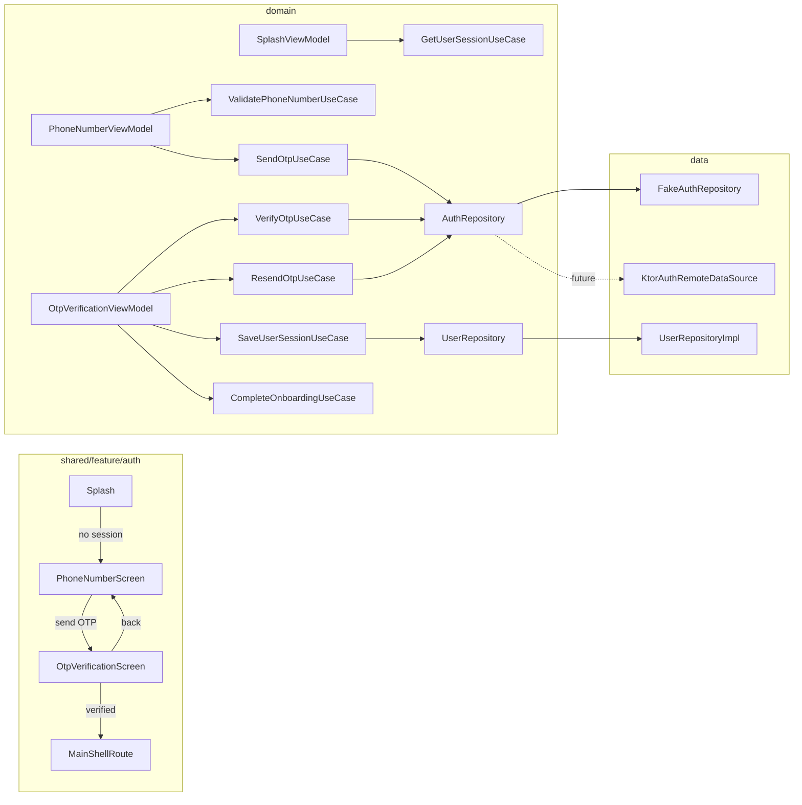
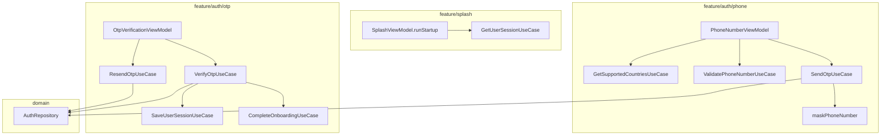

# Phone + OTP Authentication — Design Spec

**Date:** 2026-08-02  
**Status:** Approved (feature-prep)  
**Feature ID:** `phone-otp-auth`  
**Scope:** Phone Number entry + OTP verification only (no login landing, no Google verify)  
**Figma:** `Phone Number` (`12:755`), `Inert Code` (`12:35`)  
**Glossary:** [`CONTEXT.md`](../../../CONTEXT.md)

---

## Summary

Add a `feature/auth` package in `:shared` following the existing api/impl feature pattern. Unauthenticated users (no session) enter phone auth after splash: **Phone Number** → **OTP verification** → **Main**. Country code is selectable via dropdown (default Singapore +65). OTP UI matches the **Inert Code** full-screen frame (inline digit field, resend countdown, back chevron).

Domain layer owns validation and masking rules. `FakeAuthRepository` ships first; Ktor integration added when the API contract is confirmed. Human-gated workflow (AGENTS.md Phase 1/2) is **not** used for this feature — single implementation pass with fake backend.

---

## Requirements (decisions)

| Requirement | Decision |
|-------------|----------|
| Scope | Phone Number + OTP only |
| Splash routing | **Session only** — `GetUserSessionUseCase()` present → Main; absent → Auth |
| Legacy onboarding flag | Still written via `CompleteOnboardingUseCase` on OTP success; **not** read for routing |
| Carousel onboarding | **Unwire only** — remove from `App.kt` / splash; keep `feature/onboarding` files |
| Country code | Dropdown (`ExposedDropdownMenuBox`); curated list; default SG +65 |
| OTP UI reference | **Inert Code** (full-screen, not Verificaton code sheet) |
| Backend (v1) | `FakeAuthRepository`; valid code **`123456`**; Ktor-ready interfaces |
| Resend cooldown | Server-driven via `OtpChallenge.resendAvailableAtEpochMs` (fake: 30s) |
| Resend behavior | New `challengeId`; previous code invalidated |
| Masked phone | Client-computed `{dialCode} •••• {last4}`; passed via navigation args |
| Back from OTP | Pop to Phone; discard challenge; **retain** country + digits |
| Session on success | `SaveUserSessionUseCase` + `CompleteOnboardingUseCase` |

---

## Approach

**Chosen:** New `auth` feature module with internal typed navigation (Approach 1 from feature-prep).

**Rejected:**
- Repurpose `feature/onboarding` — wrong domain language
- Single-screen step state machine — harder to extend and test navigation
- Bottom sheet OTP (Verificaton code frame) — user reverted to Inert Code

---

## Architecture



### Domain models (`domain/.../model/auth/`)

```kotlin
data class CountryDialCode(
    val isoCode: String,      // "SG"
    val dialCode: String,     // "+65"
    val displayName: String,  // "Singapore"
    val flagEmoji: String,    // "🇸🇬"
)

data class PhoneNumberInput(
    val country: CountryDialCode,
    val localDigits: String,
)

/** E.164 value, e.g. "+6587654321" */
data class PhoneNumber(val e164: String)

data class OtpChallenge(
    val challengeId: String,
    val resendAvailableAtEpochMs: Long,
)

sealed class AuthError : Throwable() {
    data object InvalidPhoneNumber : AuthError()
    data object OtpSendFailed : AuthError()
    data object OtpInvalid : AuthError()
    data object OtpExpired : AuthError()
    data object TooManyAttempts : AuthError()
    data object NetworkUnavailable : AuthError()
    data object Unknown : AuthError()
}
```

### Phone validation rules (`ValidatePhoneNumberUseCase`)

| ISO | Rule |
|-----|------|
| SG | 8 digits; starts with `8` or `9` |
| MY | 9–10 digits; starts with `1` |
| TH | 9 digits; starts with `6`–`9` |
| ID | 9–12 digits; starts with `8` |
| PH | 10 digits; starts with `9` |
| VN | 9 digits; starts with `3`–`9` |

Supported countries (static list in domain): SG (default), MY, TH, ID, PH, VN.

### Masking (`PhoneNumberMasking` — domain pure function)

```kotlin
fun maskPhoneNumber(phone: PhoneNumber): String {
    // "+6587654321" → "+65 •••• 4321"
}
```

### Repository (`domain/.../repository/AuthRepository.kt`)

```kotlin
interface AuthRepository {
    fun getSupportedCountries(): List<CountryDialCode>
    suspend fun sendOtp(phone: PhoneNumber): Result<OtpChallenge>
    suspend fun resendOtp(challengeId: String): Result<OtpChallenge>
    suspend fun verifyOtp(challengeId: String, code: String): Result<UserSession>
}
```

### Use cases (`domain/.../usecase/auth/`)

| Use case | Input | Output |
|----------|-------|--------|
| `GetSupportedCountriesUseCase` | — | `List<CountryDialCode>` |
| `ValidatePhoneNumberUseCase` | `PhoneNumberInput` | `Result<PhoneNumber>` |
| `SendOtpUseCase` | `PhoneNumber` | `Result<OtpChallenge>` |
| `ResendOtpUseCase` | `challengeId: String` | `Result<OtpChallenge>` |
| `VerifyOtpUseCase` | `challengeId`, `code` | `Result<UserSession>` |

Register in `AppDomainModule.kt` via `factoryOf`.

### Data — FakeAuthRepository (v1)

```kotlin
class FakeAuthRepository : AuthRepository {
    // sendOtp: delay ~500ms; return new challengeId + now+30s
    // resendOtp: new challengeId; invalidate old
    // verifyOtp: "123456" → UserSession("fake-access", "fake-refresh"); else OtpInvalid
}
```

Bind `single<AuthRepository> { FakeAuthRepository() }` in `platformDataModule()` until Ktor is ready.

**Future Ktor paths** (not implemented in v1):

- `POST /auth/otp/send`
- `POST /auth/otp/verify`
- `POST /auth/otp/resend`

---

## Presentation (`shared/.../feature/auth/`)

| Package | Contents |
|---------|----------|
| `api/` | `AuthScreen`, `AuthNavigation`, `authFeatureModule` |
| `impl/phone/` | `PhoneNumberViewModel`, `PhoneNumberUiState`, `PhoneNumberContent` |
| `impl/otp/` | `OtpVerificationViewModel`, `OtpVerificationUiState`, `OtpVerificationContent` |

### Navigation

```kotlin
@Serializable data object AuthRoute

@Serializable data object PhoneNumberRoute

@Serializable data class OtpVerificationRoute(
    val challengeId: String,
    val maskedPhone: String,
    val resendAvailableAtEpochMs: Long,
)
```

`AuthScreen` hosts internal `NavHost`: `PhoneNumberRoute` → `OtpVerificationRoute`.

### Phone Number screen (Figma `12:755`)

**UiState:**

```kotlin
data class PhoneNumberUiState(
    val countries: ImmutableList<CountryDialCode>,
    val selectedCountry: CountryDialCode,
    val localDigits: String = "",
    val isCountryDropdownExpanded: Boolean = false,
    val phoneError: String? = null,
    val isNextEnabled: Boolean = false,
    val isLoading: Boolean = false,
    val sendError: String? = null,
)
```

**Layout:** Title + subtitle; split row (dropdown + phone field); full-width **Next** button (disabled when invalid/loading). No back chevron. Insets via `appStatusBarsPadding()` + `appNavigationBarsPadding()`.

**Interactions:**

| Event | Behavior |
|-------|----------|
| Country / digit change | Re-validate; toggle Next |
| Next | `SendOtpUseCase` → navigate to OTP with `challengeId`, `maskedPhone`, `resendAvailableAtEpochMs` |
| Send failure | Snackbar |

### OTP screen (Figma `Inert Code` `12:35`)

**UiState:**

```kotlin
data class OtpVerificationUiState(
    val maskedPhone: String,
    val digits: String = "",
    val otpError: String? = null,
    val isVerifying: Boolean = false,
    val resendSecondsRemaining: Int = 0,
    val isResending: Boolean = false,
)
```

**Layout:**

- Back chevron (30dp) → pop to Phone (retain phone input state)
- `"Enter the 6-digit code sent to:"` (16sp)
- Masked phone line (with optional blur/redaction visual)
- **Single inline OTP field** (32sp) + circular clear (×) button
- `"Didn't receive it?"` + countdown / tappable resend link
- System numeric keyboard

**Interactions:**

| Event | Behavior |
|-------|----------|
| 6th digit | Auto-submit `VerifyOtpUseCase` |
| Verify success | `SaveUserSessionUseCase` + `CompleteOnboardingUseCase` → `onAuthComplete()` |
| × clear | Reset digits; clear error |
| Resend (after countdown) | `ResendOtpUseCase` → update challenge args; reset field; new 30s timer |
| Wrong code | Inline error; keep digits |

---

## Splash changes

Replace onboarding routing with session check:

```kotlin
sealed interface SplashPostStartupDestination {
    data object Main : SplashPostStartupDestination
    data object Auth : SplashPostStartupDestination  // replaces Onboarding
}
```

`SplashViewModel` injects `GetUserSessionUseCase` instead of `HasCompletedOnboardingUseCase`:

```kotlin
val destination = if (getUserSession() != null) {
    SplashPostStartupDestination.Main
} else {
    SplashPostStartupDestination.Auth
}
```

`App.kt`: replace `OnboardingRoute` composable with `AuthRoute` / `AuthScreen`.

---

## Edge-case matrix

| ID | Scenario | Expected behavior |
|----|----------|-------------------|
| E01 | Empty phone | Next disabled |
| E02 | Partial / invalid phone | Next disabled; inline error on submit attempt |
| E03 | Country changed | Re-validate; clear error |
| E04 | Send OTP failure | Snackbar; stay on phone |
| E05 | Back from OTP | Pop; retain phone; challenge discarded |
| E06 | Wrong OTP | Inline error; digits kept |
| E07 | OTP `123456` (fake) | Success → Main |
| E08 | Resend during countdown | Disabled |
| E09 | Resend after countdown | New challengeId; field cleared |
| E10 | Existing session on splash | Skip auth → Main |
| E11 | Legacy onboarding flag, no session | Auth (session gate only) |
| E12 | Process death on OTP | Splash → Auth (no session) |

Full traceability: [`docs/superpowers/specs/2026-08-02-phone-otp-auth-test-matrix.md`](./2026-08-02-phone-otp-auth-test-matrix.md)

---

## Function relationship map



---

## Testing & verification

### Unit tests

| Layer | Focus |
|-------|-------|
| domain | `ValidatePhoneNumberUseCase` per country; `FakeAuthRepository`; use case delegation |
| shared | `PhoneNumberViewModel` validation + send navigation; `OtpVerificationViewModel` countdown, auto-submit, resend |
| shared | `SplashViewModel` session-based routing (update existing tests) |

### Commands

```bash
./gradlew :domain:test
./gradlew :shared:test
./gradlew :architecture:test
./gradlew qualityCheck
```

### Out of scope (v1)

- Login landing, Google verify
- SMS auto-read
- Country search / full international list
- Logout UI (session clear exists but no settings entry)
- Delete `feature/onboarding` package
- Real Ktor OTP endpoints
- Human-gated Phase 1/2 split

---

## Files to create / modify

### New (representative)

```
domain/.../model/auth/*.kt
domain/.../repository/AuthRepository.kt
domain/.../usecase/auth/*.kt
domain/.../util/PhoneNumberMasking.kt
domain/src/commonTest/.../fake/FakeAuthRepository.kt
domain/src/commonTest/.../usecase/auth/*.kt

data/.../auth/FakeAuthRepository.kt

shared/.../feature/auth/api/AuthScreen.kt
shared/.../feature/auth/api/AuthNavigation.kt
shared/.../feature/auth/api/AuthFeatureModule.kt
shared/.../feature/auth/impl/phone/*
shared/.../feature/auth/impl/otp/*
shared/src/commonTest/.../feature/auth/**/*
```

### Modified

```
shared/.../App.kt
shared/.../core/di/AppDomainModule.kt
shared/.../feature/splash/impl/SplashViewModel.kt
shared/.../feature/splash/impl/SplashScreenUiState.kt
shared/.../feature/splash/api/SplashScreen.kt
shared/src/commonTest/.../feature/splash/impl/SplashViewModelTest.kt
data/.../di/PlatformDataModule.{android,ios}.kt
```

---

## Phase 2 technology notes (deferred)

| Capability | When ready |
|------------|------------|
| Ktor OTP API | Swap `FakeAuthRepository` → `AuthRepositoryImpl` + `KtorAuthRemoteDataSource` |
| `ApiPaths` entries | Add `/auth/otp/send`, `/verify`, `/resend` |
| Error mapping | HTTP 400→`OtpInvalid`, 429→`TooManyAttempts`, etc. |
| Analytics | Optional `auth_otp_sent` / `auth_otp_verified` events |

---

## Grill resolutions (Phase B)

| # | Question | Answer |
|---|----------|--------|
| 1 | Splash routing | Session only (A) |
| 2 | Backend | Fake first, Ktor-ready (A) |
| 3 | Resend cooldown | Server-driven timestamp (A) |
| 4 | Back from OTP | Retain phone + country (A) |
| 5 | Fake valid code | `123456` (A) |
| 6 | Carousel code | Unwire only (A) |
| 7 | Masked phone | Client-computed (A) |
| 8 | Resend challenge | New challengeId (A) |
| 9 | Human-gated workflow | **Skipped** — single implementation pass |
